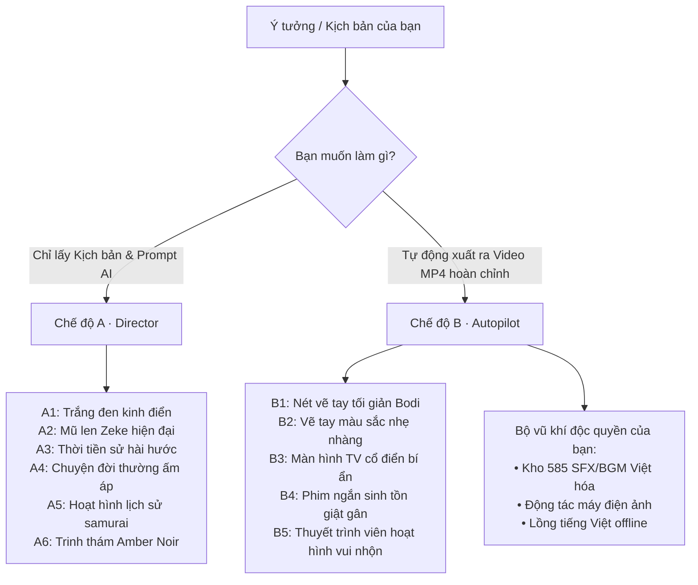

# Tổng Quan Tính Năng Stickman Video Director (Dành Cho Nhà Sáng Tạo Nội Dung)

Tài liệu này dành riêng cho người dùng/nhà sáng tạo nội dung (Content Creator) muốn hiểu rõ toàn bộ khả năng của kho lưu trữ này và các tính năng mới nhất mà **không cần bận tâm đến mã nguồn (code)**.

---

## 1. Giới thiệu chung: Đây là công cụ gì?

Kho lưu trữ này là một **Xưởng sản xuất video hoạt hình người que (Stickman)** thông minh được điều khiển bởi AI.

Công cụ hỗ trợ bạn biến mọi **ý tưởng thô, bài viết, kịch bản hoặc chủ đề** thành video hoạt hình cuốn hút thông qua **2 chế độ làm việc chính** và **10 phong cách thị giác độc đáo**:

---

## 2. Bảng so sánh 2 chế độ làm việc

| Tiêu chí | Chế độ A · Director (Đạo diễn) | Chế độ B · Autopilot (Tự động sản xuất) |
| :--- | :--- | :--- |
| **Bản chất** | Thiết kế kịch bản & viết Prompt AI | Xưởng tự động sản xuất ra video hoàn chỉnh |
| **Đầu vào từ bạn** | 1 chủ đề, bài báo, câu chuyện hoặc kịch bản thô. | Kịch bản hoặc nội dung thoại cần đọc. |
| **Kết quả nhận về** | Kịch bản 5 hồi cuốn hút + Danh sách câu lệnh (Prompts) tiếng Anh phân cảnh chuẩn 10 giây. | File video **MP4 hoàn chỉnh** gồm: **Hình ảnh + Giọng đọc + Phụ đề khớp từng từ + Diễn hoạt + Hiệu ứng âm thanh & Nhạc nền**. |
| **Cách dùng tiếp theo** | Copy các prompt dán vào AI Video Generator bên ngoài (**Sora, Runway Gen-3, Kling, Midjourney, Google Veo**). | Đăng ngay lên mạng xã hội (**TikTok, YouTube Shorts, Reels**). |
| **Mục tiêu phù hợp** | Cần chất lượng đồ họa 3D/AI cinematic đỉnh cao từ các mô hình AI lớn. | Cần sản xuất nhanh hàng loạt video ngắn hoàn chỉnh ngay trên máy tính mà không cần dựng tay. |

---

## 3. Chi tiết 10 phong cách thị giác (Visual Styles)

### Nhóm A · Lấy Prompt & Kịch bản điện ảnh (Director Mode)

1. **A1 (Classic Minimalist - Kinh điển tối giản)**:
   - *Hình ảnh*: Người que nét vẽ đen trên nền trắng hoặc nét phát sáng trên nền đen.
   - *Ứng dụng*: Video giải thích tài chính, công nghệ, bài học triết lý, tips năng suất.
2. **A2 (Modern Beanie Zeke - Trẻ trung hiện đại)**:
   - *Hình ảnh*: Nhân vật người que đội mũ len đỏ, áo phông vàng đặc trưng.
   - *A2A (Tech Studio)*: Đứng trong phòng lab công nghệ cao, giao diện kính tương lai màu xanh neon.
   - *A2B (Cinematic Story)*: Bối cảnh thành phố điện ảnh đầy đủ màu sắc và ánh sáng chiều sâu.
3. **A3 (Prehistoric - Thời tiền sử)**:
   - *Hình ảnh*: Người que mặc trang phục da thú, sống trong hang động kỷ băng hà.
   - *Ứng dụng*: Kể chuyện châm biếm, hài đen, so sánh giữa thế giới cổ đại và hiện đại.
4. **A4 (Cozy Storytelling - Chữa lành đời thường)**:
   - *Hình ảnh*: Nhân vật người que tối giản hòa mình vào tranh vẽ 2D màu sắc ấm cúng (quán cà phê góc phố, chuyến tàu điện ngầm, hoàng hôn).
   - *Ứng dụng*: Video tâm sự, truyện ngắn đời sống, podcast chữa lành.
5. **A5 (Historical Cartoon - Hoạt hình lịch sử)**:
   - *Hình ảnh*: Nhân vật người que trong trang phục lịch sử (samurai Nhật Bản thời Edo, hiệp sĩ trung cổ, quý tộc La Mã).
   - *Ứng dụng*: Tóm tắt lịch sử, dã sử, phân tích chiến thuật chiến tranh.
6. **A6 (Amber Noir - Trinh thám bóng tối)**:
   - *Hình ảnh*: Nhân vật mặc áo hoodie cam bí ẩn giữa khung cảnh thành phố đêm đầy bóng đổ và ánh đèn vàng ấm áp.
   - *Ứng dụng*: Trinh thám, phá án, giải mã bí mật đen tối.

---

### Nhóm B · Tự động sản xuất video hoàn chỉnh (Autopilot Mode)

1. **B1 (Minimal Line Art - Vẽ tay tối giản)**:
   - Nét vẽ tay trên nền giấy caro mờ, biểu cảm phóng đại cực kỳ linh hoạt, phụ đề chữ viết tay xuất hiện tự nhiên khớp theo nhịp giọng đọc.
2. **B2 (Colorful Hand-Drawn - Tranh vẽ màu nhẹ nhàng)**:
   - Tranh vẽ tay phong cách màu sáp êm dịu, chuyển động mềm mại, hợp chủ đề suy ngẫm, triết lý sống.
3. **B3 (Retro TV - Truyền hình cổ điển thập niên 90)**:
   - Tái hiện màn hình tivi CRT quét tia cổ điển, phong cách bí ẩn, rất hợp làm video kể chuyện kinh dị hoặc bí ẩn lúc 3 giờ sáng.
4. **B4 (Survival Thriller - Phim ngắn sinh tồn giật gân — MỚI NÂNG CẤP)**:
   - **Đặc sản**: Làm các video **Quy tắc sinh tồn, Cuộc gọi 911, Đếm ngược sinh tử, Creepypasta**.
   - **Mở đầu giật gân (Hook Preset)**: Tiêu đề xuất hiện bằng font bo tròn đậm Nunito kèm hiệu ứng nảy chữ (scale-settle) gây sốc.
   - **Quy tắc 3 giây đầu**: Trong 3 giây đầu, biểu cảm nhân vật phải chuyển biến mạnh mẽ (từ lo âu sang kinh hãi tột độ, lùi lại, giật mình), kết hợp tiếng thở dốc, kim đồng hồ tích tắc và tiếng radio rè rè.
5. **B5 (Character Explainer - Thuyết trình viên hoạt hình — MỚI BỔ SUNG JENSEN)**:
   - **Đặc sản**: Dạng video **thuyết trình viên đứng góc trái sân khấu**, vừa nói vừa chỉ tay sang bên phải màn hình để giải thích sơ đồ, hình ảnh minh họa hoặc biểu đồ.
   - Có thêm bộ nhân vật mẫu **Jensen Huang** (bên cạnh Spider-Man) với đầy đủ diễn hoạt tay chân, các mảng miếng hài thể chất (khóc mếu, ngã nhào, giật mình), phụ đề hỗ trợ tối đa 3 dòng.

---

## 4. Ba "vũ khí" độc quyền trên kho của bạn (Local Fork)

Kho lưu trữ này của bạn không chỉ có các tính năng gốc từ tác giả kaomei mà còn được tích hợp sẵn 3 tiện ích cao cấp dành riêng cho thị trường Việt Nam:

1. **Kho 585 Âm thanh cục bộ (`sfx-thu-vien`)**:
   - 439 hiệu ứng âm thanh (SFX) phân thành 50 danh mục + 146 bài nhạc nền (BGM) chất lượng cao.
   - Bạn chỉ cần nói: *"Hãy thêm tiếng đấm vào giây 01.5, tiếng tim đập hồi hộp làm nền"*, hệ thống sẽ tự động dò tìm trong máy và khớp chính xác vào video.
2. **Bộ công cụ chuyển động điện ảnh (Cinematic Motion Toolkit)**:
   - Tích hợp các góc máy điện ảnh: *Whip Pan (lia máy cực nhanh), Zoom giật (Crash Zoom), Khung hình nghiêng (Dutch Angle), Phân đôi màn hình (Split-Screen)*.
3. **Lồng tiếng & Phụ đề Tiếng Việt chuẩn xác**:
   - Tích hợp giọng đọc tiếng Việt offline và căn chỉnh phụ đề khớp từng từ (`faster-whisper`), không phụ thuộc API trả phí hay VPN.
   - Thư mục làm việc `projects/` được bảo mật hoàn toàn, không bao giờ bị đẩy lên mạng.
4. **Tương thích 100% cả macOS lẫn Windows**:
   - Chạy trên máy tính Windows (ổ D:) hoặc máy Mac (Home `~`) đều tự động nhận diện đường dẫn mượt mà, không gặp lỗi hệ điều hành.

---

## 5. Hướng dẫn ra lệnh mẫu (Prompting Guide)

Khi bạn muốn AI hỗ trợ làm video, bạn chỉ cần gửi yêu cầu bằng ngôn ngữ tự nhiên:

### Mẫu 1: Nhờ làm Đạo diễn kịch bản (Chế độ A)
> *"Tôi muốn làm 1 video ngắn 60 giây theo phong cách A1 (trắng đen tối giản) về chủ đề: 'Nghịch lý của sự lựa chọn - Càng nhiều lựa chọn con người càng bất hạnh'. Hãy lên kịch bản 5 hồi và viết prompt tạo video cho tôi."*

### Mẫu 2: Nhờ tự động dựng video ngắn hoàn chỉnh (Chế độ B4 Sinh tồn)
> *"Hãy dùng chế độ B4 (Survival Thriller) để sản xuất video ngắn TikTok 30 giây: '3 quy tắc sống còn khi bị lạc trong rừng vào ban đêm'. Hãy dùng mở đầu giật gân, chèn tiếng gió rít và tiếng bước chân từ thư viện SFX."*

### Mẫu 3: Nhờ làm video thuyết trình hài hước (Chế độ B5 Explainer)
> *"Tôi muốn làm video thuyết trình vui nhộn phong cách B5 giải thích: 'Tại sao máy bay không bay qua Thái Bình Dương?'. Cho nhân vật đứng bên trái giải thích, thêm các pha trượt chân hài hước và hiệu ứng âm thanh ngộ nghĩnh."*

### Mẫu 4: Tra cứu âm thanh trong kho
> *"Tìm giúp tôi 3 âm thanh tiếng va chạm/đấm mạnh và 1 đoạn nhạc nền kịch tính trong thư viện sfx để gắn vào đoạn cao trào."*
